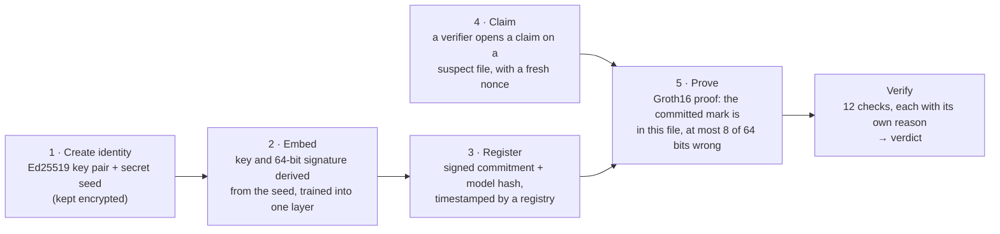

# OWASP AI Model Watermarking: Sigil

**Hide a secret watermark in a neural network's weights, then prove the model is yours with a zero-knowledge proof that reveals nothing about the watermark.**

[](LICENSE)
[](circuits/LICENSE)


A final-year B.E. project, Department of Computer Science and Engineering (IoTCSBCT), Anjuman-I-Islam's
M. H. Saboo Siddik College of Engineering, Mumbai (University of Mumbai), 2026–27, under the guidance of
**Dr. Mohd. Shafi Pathan**.

The project is aligned with the [OWASP AI Model Watermarking](https://owasp.org/www-project-ai-model-watermarking/)
incubator project. **It is not official OWASP work** and is not published or endorsed by OWASP.

---

## Contents

- [The problem and our answer](#the-problem-and-our-answer)
- [Key results](#key-results)
- [How it works](#how-it-works)
- [What is in the box](#what-is-in-the-box)
- [The six demos](#the-six-demos)
- [Quick start](#quick-start)
- [Using the SDK and command line](#using-the-sdk-and-command-line)
- [The backend](#the-backend-fastapi--postgresql)
- [Tests](#tests)
- [Repository layout](#repository-layout)
- [Documentation](#documentation)
- [Limitations](#limitations)
- [Status and roadmap](#status-and-roadmap)
- [Team](#team)
- [Licence](#licence)

---

## The problem and our answer

A trained model costs data, compute and time, and it is easy to copy. If someone republishes your model as
theirs, you need proof of ownership that doesn't hand them your secret.

**Watermarking** writes a secret signature into the model's weights. **Zero-knowledge (ZK) proofs** let the
owner prove the signature is there without revealing it. Combining the two is not new, and this project shows
why the obvious combination is not enough:

- **Uncommitted ZK ownership proofs can be forged.** In earlier schemes (for example ZKROWNN, DAC 2023) the
  prover chooses the watermark key at proof time. A thief can fit a key to someone else's model, and the forged
  proof verifies under the owner's own verification key.
- **A committed seed fixes this.** The owner commits to a secret seed before releasing the model; the
  watermark key and signature are both derived from that seed, and the circuit re-derives them itself. A thief
  can't invent a key afterwards.

**What is and isn't new.** Committing to a watermark key, timestamping it, deriving the watermark from a hash or
a signature, and proving ownership in ZK all have prior work (Adi et al., USENIX Security 2018; Li et al., arXiv
1910.01226; NeuralMark, AAAI 2026; FedZKP, arXiv 2305.04507). Our contribution is narrower: a SNARK proof of
Uchida-style white-box extraction in which **both the key and the signature are derived inside the circuit**
from a committed seed bound to an authenticated owner key, with the acceptance threshold enforced in the
circuit and the proof bound to the suspect model file. Around it come measured forgery (RQ1), robustness × ZK
(RQ2) and cost (RQ3) results. See [01_Literature_Gap_Analysis.md](01_Literature_Gap_Analysis.md) §3.4.

The system is evaluated against two **project requirements** we derived from the OWASP AI Exchange
`#MODEL WATERMARKING` text: watermarks should "remain detectable even if the model is modified" (**R1,
robustness**) and should "avoid ambiguity where multiple parties could plausibly claim ownership of the same
model" (**R2, non-ambiguity**). The R1/R2 labels are ours, not OWASP's.

## Key results

Every number below comes from a results file in this repository (`demo/results/`, `experiments/results/`,
`experiments/robustness/results/`) and the reports in [`docs/reports/`](docs/reports/).

| | Result |
|---|---|
| Accuracy cost of the 64-bit mark (MNIST CNN) | 98.69% → 98.66% (−0.03 percentage points) |
| False accepts on never-watermarked models | 0 of 30 models (rule: at most 8 of 64 bits wrong; chance for a random model ≈ 2.8 × 10⁻¹⁰) |
| Forgery without a commitment (demos C, E) | A thief's key reads "MALLORY!" with 0 bits wrong; the forged EZKL proof verifies under the owner's key |
| Forgery against the committed seed (demo D) | 0 of 20,000 attempts; ≈ 2³² tries needed at 64 bits, ≈ 2¹²⁰ at 256 bits |
| Removal attacks the mark survives | Pruning up to 95%, int8/int4 quantisation, fine-tuning, re-training, a thief's overwrite |
| Attacks that remove it | Channel permutation (undone by owner-side realignment) and model extraction |
| Groth16 proof, 64-bit mark | 116,822 constraints · 3.9 s to prove · 0.41 s to verify · 741-byte proof |
| Groth16 proof, 256-bit mark | 402,292 constraints · 11.6 s to prove · 0.41 s to verify |
| On-chain verification (local EVM) | 243,225 gas; a tampered public signal is rejected |
| Automated tests | 491 (pytest), plus a deployment check that makes and verifies a real proof |

## How it works



1. **Create an identity.** The owner makes an Ed25519 key pair and a uniform secret seed. Both are stored
   encrypted with the owner's passphrase (encrypted PKCS#8 for the key, scrypt + AES-GCM for the seed).
2. **Embed.** A ±1 key matrix *X* and a signature *b* are derived from the seed and the owner's public-key hash
   with domain-separated Poseidon hashing. A regulariser trains *b* into one layer (Uchida et al.): the sign of
   *X · w* reads out the signature, where *w* is the layer's averaged weights.
3. **Register.** The owner publishes a signed record holding the commitment *C = Poseidon(seed, pk_hash,
   config_hash)*, the configuration and the model file's SHA-256. A registry timestamps it; the earliest
   registration wins a dispute.
4. **Claim.** A verifier opens a claim on a suspect file with a fresh random nonce, so an old proof can't be
   replayed.
5. **Prove and verify.** The circuit (`circuits/ownership.circom`) opens the commitment, re-derives *X* and *b*,
   recomputes the bits from the suspect weights and enforces the threshold. Its public signals are pk_hash,
   config_hash, the commitment, the hash of the suspect weights and the nonce. The verifier recomputes
   everything it can from its own copy of the suspect file and checks the owner's signature, the registry
   timestamp, the claim, every public signal and the SNARK.

The full specification, with test vectors, is [docs/protocol.md](docs/protocol.md).

## What is in the box

| Component | What it does |
|---|---|
| **`sigil` SDK and CLI** ([`sdk/`](sdk/)) | Protocol v2, a Poseidon implementation bit-exact with circomlib, Ed25519 identities, signed registrations and receipts, PyTorch / Keras / ONNX adapters with safe loading, embedding, a library of 15 attacks, ZK prove and verify, JSON Schemas for every file format |
| **ZK circuit** ([`circuits/`](circuits/)) | Circom 2 circuit, scripted Groth16 trusted setup (public Powers of Tau + our phase-2 contribution), verification keys and setup transcripts, a Solidity verifier tested on a local EVM |
| **Demo web app** ([`demo/`](demo/), [`frontend/`](frontend/)) | A local server (`demo/server.py`) and a React + TypeScript dashboard: research demos A–F, Embed, Verify ownership (with misuse attempts and on-chain view), Robustness lab, and a *Model under test* bar that tests any model live |
| **Backend** ([`backend/`](backend/)) | FastAPI + PostgreSQL: accounts and roles, model uploads, registry, claims, proofs and verifications, a hash-chained audit log, ownership certificates (PDF + signed JSON), deployment monitoring |
| **Experiments** ([`experiments/`](experiments/)) | ±1-key parity study, robustness matrix (5 seeds), null-model calibration, ZK-in-the-loop column, proof cost benchmark |

## The six demos

| Demo | What it shows | Live run |
|---|---|---|
| **A · Commit & embed** | The owner publishes a hash of the secret seed and embeds the mark; accuracy drops by about 0.03 points | ~5 s |
| **B · Removal attacks** | Pruning, quantisation, fine-tuning, overwriting and permutation, and which of them remove the mark | ~10 s |
| **C · Ownership forgery** | Without a commitment, a thief fits a fake key ("MALLORY!") to the owner's model | ~3 s |
| **D · Committed seed** | The fix without zero knowledge: 0 of 20,000 forgery attempts succeed | ~3 s |
| **E · Zero-knowledge proofs** | With EZKL, the thief's forged proof verifies under the owner's own key | ~10 s |
| **F · Protocol v2** | The full fix: a real Circom + Groth16 proof, every verifier check, the thief, misuse attempts, attacks and the overwrite dispute | ~80 s |

## Quick start

Everything runs locally; nothing is sent to a cloud service, and the server only listens on `127.0.0.1`.

**Replay mode** (about a minute, needs only Python 3.10+). The Run buttons replay recorded real runs:

```bash
python demo/server.py --simulate        # then open http://127.0.0.1:8765
```

**Live mode** (5–15 minutes of setup, needs Python 3.10+ and Node.js 20.19+):

```bash
./setup.sh --demo --zk-setup            # Windows: .\setup.ps1 --demo --zk-setup
.venv/bin/python scripts/verify_deploy.py   # Windows: .venv\Scripts\python scripts\verify_deploy.py
.venv/bin/python demo/server.py --open      # Windows: double-click Start-Demo-UI.cmd
```

The setup creates `.venv` (Python 3.12, PyTorch, the SDK), installs SnarkJS and circom, and with `--zk-setup`
runs the Groth16 setup for the 64-bit circuit (a one-time Powers of Tau download, about 3 minutes). The
proving keys are not stored in git. `verify_deploy.py` must end with `ALL CHECKS PASSED`; it runs the tests,
starts the app and makes and verifies a real proof. Add `--gpu` to the setup for the CUDA build of PyTorch.

Then open **http://127.0.0.1:8765**, press **Open dashboard**, **Run all live** (demos A–E) and **Run demo F
live**. [DEMO.md](DEMO.md) is the presenter runbook and [DEPLOY.md](DEPLOY.md) the step-by-step deployment
guide with troubleshooting.

> `demo/ckpt/owner_secret.json` and the keys in `demo/ckpt/v2/` are the demo's identities. They are committed on
> purpose (encrypted with a public demo passphrase) so the saved results stay reproducible. They are demo
> values, not real secrets.

## Using the SDK and command line

```bash
pip install -e "./sdk[torch,onnx]"      # add [tf] for Keras, [attacks] for the attack library
cd circuits && npm install              # SnarkJS and circomlib for proving
```

**Owner**, once per model:

```bash
sigil keygen                                          # secrets/owner.key (Ed25519, encrypted)
sigil seed --bits 64 --layer conv2                    # secrets/seed.json (encrypted seed + configuration)
sigil embed model.pt --arch mymodels:Net --data train.npz   # model.wm.pt, or nothing if the mark didn't take
sigil detect model.wm.pt                              # bits wrong out of T; accepted?
sigil register model.wm.pt --registry-key secrets/registry.key   # registration.json + registry receipt
```

**In a dispute**, the verifier opens a claim, the owner proves, the verifier checks:

```bash
sigil claim registration.json --suspect suspect.onnx            # claim.json with a fresh nonce
sigil prove suspect.onnx --claim claim.json --out bundle        # bundle/: proof, public signals, claim, manifest
sigil verify bundle --suspect suspect.onnx --registration registration.json \
             --receipt registration.receipt.json --trusted-registry <registry public key>
sigil report bundle ...same options... --out report.md         # the same checks, written up as a report
```

**Robustness**: `sigil attack prune model.wm.pt --arch mymodels:Net --ratio 0.9 --eval test.npz` writes an
attacked copy; 15 attacks are available (`sigil attack --help`).

The Python API, the security rules the SDK enforces and the file formats are in [sdk/README.md](sdk/README.md).
Example notebooks for PyTorch, Keras and any-format verification are in [`sdk/examples/`](sdk/examples/).

## The backend (FastAPI + PostgreSQL)

```bash
pip install -r backend/requirements.txt
python -m backend.app --simulate        # http://127.0.0.1:8765; SQLite by default, PostgreSQL 16 via docker compose
```

It serves the same web app and the demo API, plus an authenticated v2 API (OpenAPI spec in
[`contract/openapi.json`](contract/openapi.json)) with owner, verifier and admin roles, model
uploads with size and type checks, registry receipts, claims and proofs, persisted verifications with named
reasons, a hash-chained audit log, ownership certificates and compliance reports, and deployment monitoring.
See [docs/backend.md](docs/backend.md), [docs/api.md](docs/api.md) and the [ER diagram](docs/er-diagram.md).

## Tests

```bash
.venv/bin/python -m pytest -q           # everything: server, protocol, SDK, circuit, backend (~2 min)
.venv/bin/python -m pytest -q -m "not ml and not zk"    # the quick subset CI runs without the ML stack
```

The suite covers the Python reference against the circuit, end-to-end proofs with every rejection case
(forged key, different model, replay, tampered proof, untrusted registry, claim before registration), safe
model loading, the backend's security middleware and roles, the audit chain, and a scan that no saved
artefact contains key material.

## Repository layout

| Path | What |
|---|---|
| [`sdk/`](sdk/) | The `sigil` Python SDK and CLI, with tests and notebooks |
| [`circuits/`](circuits/) | `ownership.circom`, verification keys and setup transcripts (`keys/`), Solidity verifier (`onchain/`) |
| [`demo/`](demo/) | Demo scripts A–F, the demo server, trained models (`ckpt/`), MNIST (`data/`), saved results (`results/`) |
| [`frontend/`](frontend/) | React + TypeScript web app; `dist/` is the prebuilt UI the server serves |
| [`backend/`](backend/) | FastAPI app, SQLAlchemy models, Alembic migrations, reports and monitoring |
| [`experiments/`](experiments/) | Parity, robustness and cost studies, with configs and results |
| [`contract/`](contract/) | API types, OpenAPI spec, captured fixtures and recorded logs |
| [`docs/`](docs/) | Specification, threat model, reports, guides, the project report and the presentation material |
| [`scripts/`](scripts/) | Setup, deployment check, offline-build check, packaging |
| [`tests/`](tests/) | Server, demo, backend and contract tests |

## Documentation

| Document | What it covers |
|---|---|
| [docs/Sigil_BlueBook_Report.pdf](docs/Sigil_BlueBook_Report.pdf) | The project report |
| [OWASP AI Model Watermarking - Updated.pptx](OWASP%20AI%20Model%20Watermarking%20-%20Updated.pptx) | The review presentation (15 slides) |
| [docs/Sigil-Project-Guide.pdf](docs/Sigil-Project-Guide.pdf) | The project explained in four parts, one per presenter, with set-up steps |
| [Sigil-User-Guide.pdf](Sigil-User-Guide.pdf) | Illustrated user guide: install, every screen, walkthroughs, SDK, results, limits |
| [DEPLOY.md](DEPLOY.md) | Step-by-step deployment and troubleshooting |
| [DEMO.md](DEMO.md) | Presenter runbook |
| [docs/protocol.md](docs/protocol.md) | Protocol v2 specification |
| [docs/threat-model.md](docs/threat-model.md) | Application threat model (assets, trust boundaries, STRIDE) |
| [docs/reports/](docs/reports/) | Parity study, framework adapters, robustness (M5) and proof cost (ZK-10) reports |
| [01_Literature_Gap_Analysis.md](01_Literature_Gap_Analysis.md) | Literature review and gap analysis, every source verified |
| [UI_INTEGRATION.md](UI_INTEGRATION.md) | How a UI talks to the server: every endpoint and field |
| [docs/backend.md](docs/backend.md), [docs/api.md](docs/api.md) | Backend operations and API |
| [REQUIREMENTS.md](REQUIREMENTS.md), [WORKFLOW.md](WORKFLOW.md) | Requirements with acceptance criteria, and the build plan |
| [docs/SOP.pdf](docs/SOP.pdf) | The project's statement of purpose (SOP) and role distribution |

## Limitations

These are stated in the app and the presentation as well:

- **Model extraction removes the mark.** Training a fresh model from this model's answers loses the
  white-box mark; in our MNIST tests the committed trigger-set mark did not survive extraction either.
- **Permutation hides it** until the owner realigns the model.
- **64 bits is the demo size.** A seed search costs about 2³² tries at 64 bits, which a GPU can do; the secure
  setting is 256 bits (about 2¹²⁰ tries). Registry timestamps still decide disputes.
- **Groth16 needs a trusted setup.** We use a public Powers of Tau file plus our own phase-2 contribution.
- **EZKL** (demo E) has no open-source licence and is used for research comparison only.
- Results so far are on an MNIST CNN; the CIFAR-10 ResNet-18 evaluation is next.

## Status and roadmap

**Done:** protocol v2 with committed seeds, Ed25519 identities and registry timestamps; the Circom + Groth16
pipeline with on-chain verification; the `sigil` SDK and CLI for PyTorch, Keras and ONNX; the demo web app;
the MNIST robustness study; the FastAPI + PostgreSQL backend; proof cost benchmarks.

**Next:** CIFAR-10 ResNet-18 and 256-bit evaluation, a defence against model extraction, the new dashboard on
the backend, and the final report and viva.

## Team

| Member | Roll no. | Role |
|---|---|---|
| **Sami Daire** | 231813 | Project lead; protocol, zero-knowledge proofs and verification |
| **Mohamed Ansari** | 231803 | AI and watermarking; robustness |
| **Arfat Shaikh** | 231846 | Frontend and integration; SDK packaging |
| **Yash Bandiwadekar** | 231810 | Backend developer |

**Guide:** Dr. Mohd. Shafi Pathan.

## Licence

The SDK, backend and frontend are licensed under [Apache-2.0](LICENSE). The circuits in [`circuits/`](circuits/)
are [GPL-3.0](circuits/LICENSE) because they build on circomlib.
