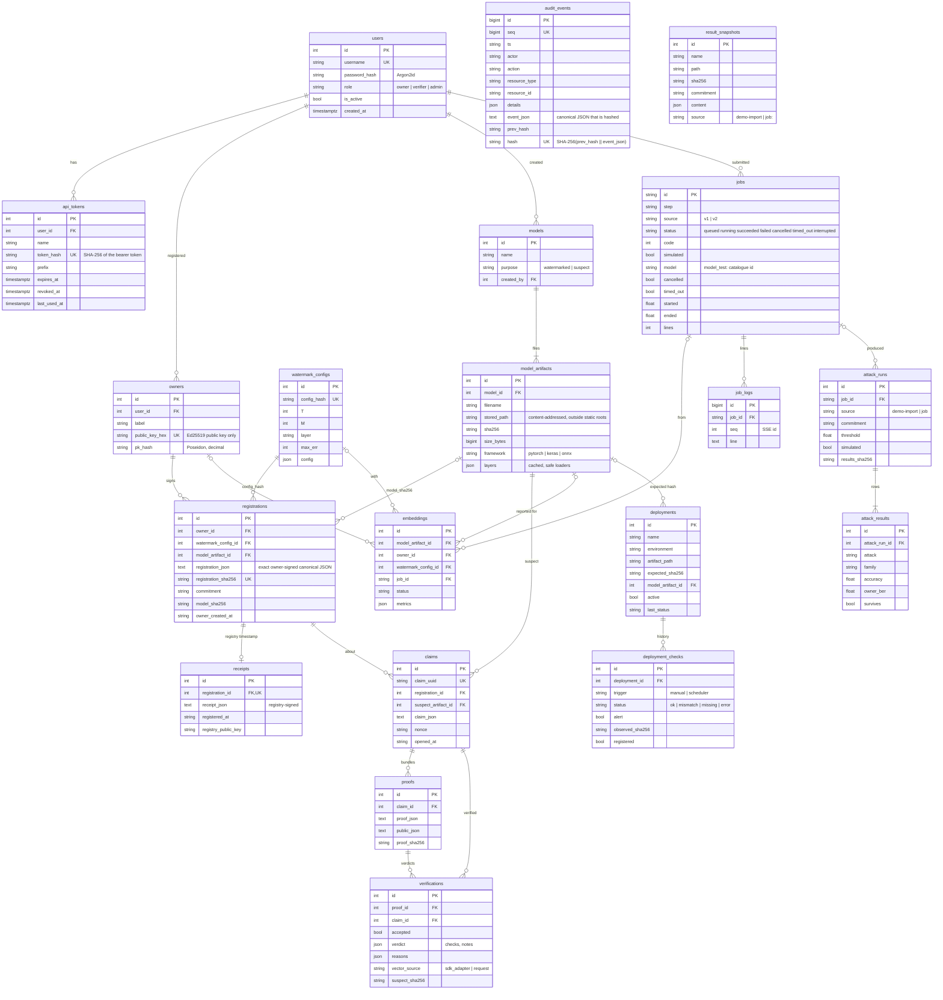

# Database schema (DB-02)

PostgreSQL 16 (SQLite for tests). Source of truth: `backend/app/models.py`; created by the Alembic migration
`backend/migrations/versions/0001_initial_schema.py` (a test checks the two agree). Timestamps are UTC.

Notes:
* `audit_events` is append-only: triggers refuse UPDATE, DELETE and (PostgreSQL) TRUNCATE (DB-03). It has no
  foreign keys on purpose, so the log outlives the rows it describes.
* `result_snapshots` is unique on (`name`, `sha256`): each distinct version of a demo result file is kept once
  (DB-04).
* Signed records are stored as the exact text that was signed, so signatures re-verify byte for byte.
