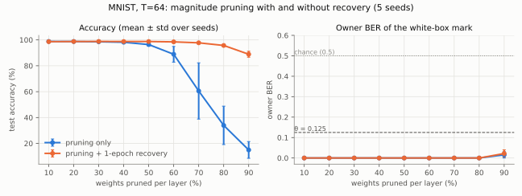
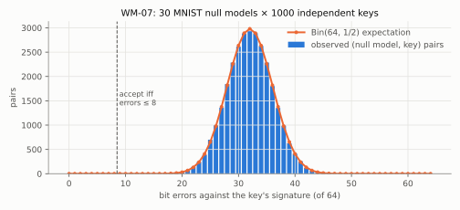
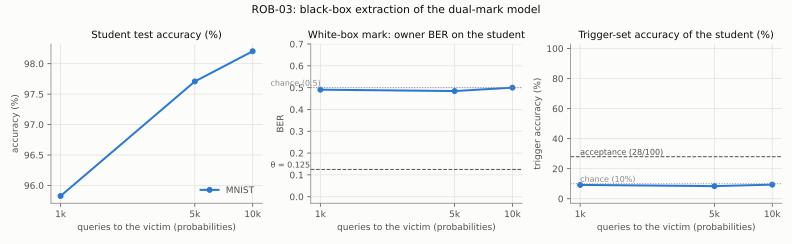

# M5 robustness and evaluation (ROB-01 – ROB-08, WM-06, WM-07, WM-09, FIX-16)

> Generated by `experiments/robustness/make_report.py` from `experiments/robustness/results/*.json`. Do not edit by hand: re-run the experiments and the generator.

**Runs:** commit(s) 02e2b9d116 (dirty), 6d7c0e08f6, d9aa077918, fb7a9bf4d1; torch 2.14.1+cu130; NVIDIA GeForce RTX 4060 Laptop GPU; Python 3.12.13. GPU-busy time summed over the result files: **26 min** (timed around GPU work inside each script; jobs partly ran concurrently on a GPU shared with another workload, which inflates these times).

## 1. Headline results

- **MNIST (T=64, 5 seeds):** the white-box mark costs -0.10 ± 0.11 pp of accuracy and survives 43 of 50 attack rows in every seed. Rows that remove it in at least one seed: permutation, permutation + FTAL 5 ep, distillation (white-box student, τ=4.0, 10 ep), extraction 1k queries (probs), extraction 5k queries (probs), extraction 10k queries (probs), extraction 10k queries (labels). Of those, the ones costing the attacker ≤ 1 pp: permutation, permutation + FTAL 5 ep, distillation (white-box student, τ=4.0, 10 ep), extraction 10k queries (probs), extraction 10k queries (labels).
- **WM-07, MNIST:** 0/150 (null model, owner key) pairs accepted at max_err = 8 (95% Clopper–Pearson upper bound 0.0243); pooled over 30000 independent keys: 0/30000 (upper bound 1.23×10^-4), against the binomial reference P[Bin(64, 1/2) ≤ 8] = 2.78×10^-10.
- **Extraction (ROB-03):** a student trained on 10k victim outputs reaches 98.20 ± 0.17 % on MNIST; the white-box mark is gone (owner BER 0.50 ± 0.14, survived 0/5), and the trigger-set mark is accepted in 0/5 seeds (trigger accuracy 9.40 ± 1.67 %).
- **ZK in the loop (ROB-05), T = 64:** 43/50 attacked MNIST models (seed 0) yield a verifying Groth16 proof; the proof verdict equals the watermark verdict in 50/50 rows.

## 2. Method (ROB-04)

- **Data.** MNIST: owner `train[0:50000]`, attacker `train[50000:60000]` (disjoint), test `t10k (10k)`.
- **Seeds.** MNIST [0, 1, 2, 3, 4]. Each seed fixes the model initialisation and batch order; attacks get their own seed. Every cell is mean ± sample std over seeds; 'survived' counts seeds.
- **Detection = what the circuit checks.** The owner's protocol-v2 key and signature (`sigil.protocol`), the Uchida vector of the marked layer quantised with scale 2^16, and *survived* iff errors ≤ max_err (θ = max_err/T = 8/64 on MNIST). θ is the one calibrated in §4 (WM-07).
- **Attacker's accuracy cost** = accuracy of the stolen (marked) model − accuracy after the attack, in percentage points, on the 10k test set.
- **Quantisation** (FIX-16): symmetric post-training quantisation, one scale per output channel (per-tensor for comparison with the old demo), scale rule and round-half-to-even exactly as torch.ao's observers (unit-tested against them); W8A8/W4A8 rows also fake-quantise every conv/linear input with a MinMax-calibrated per-tensor scale. Biases stay float as in int8 backends.
- **Pruning + recovery** keeps the pruning mask during fine-tuning; **fine-pruning** follows Liu et al. (2018): prune the least-activated channels of a layer on clean attacker data, then fine-tune.
- **Owner-side realignment (ROB-06)** does not know the thief's permutation and does not use the suspect's pre-attack weights. Assumption: the owner holds their own copy of the marked model (the model they trained and registered). Channels are matched by cosine similarity of the producer's filters and the consumer's input slices, solved as a one-to-one assignment (Hungarian). The permutation is disclosed with the claim so the verifier can re-apply it to the suspect file.
- **Extraction (ROB-03)** is black-box: the attacker sends their own inputs once, keeps the returned probabilities (or labels) and trains a fresh model of the same architecture on those pairs only.
- **Trigger set (WM-06).** n = 100 images and labels derived from (seed, pk_hash) with SHA-256 (`sigil.triggerset`), committed by SHA-256; accepted iff ≥ 28 of 100 labels match, a false-positive rate ≤ 1e-06 under the exact Bin(n, 1/10) null.
- **Configs** (versioned YAML, ROB-04): `experiments/robustness/mnist.yaml` (sha256 7123eedc4869), `experiments/robustness/mnist_nulls.yaml` (sha256 ce81461f3eb1).

## 3. MNIST matrix (demo CNN, T = 64, M = 288, layer `conv2`)

| Model | Test accuracy (%) | Cost vs clean (pp) | Owner errors (of 64) | Trigger accuracy (%) |
|---|---|---|---|---|
| clean | 98.69 ± 0.18 | – | 30.8 ± 4.1 | 9.2 ± 3.3 |
| wm | 98.79 ± 0.18 | -0.10 ± 0.11 | 0.0 ± 0.0 | 10.6 ± 3.5 |
| dual | 98.71 ± 0.15 | -0.02 ± 0.28 | 0.0 ± 0.0 | 100.0 ± 0.0 |

### 3.1 White-box mark under attack (T = 64, 5 seeds; proof column: seed 0)

| Attack | Accuracy (%) | Attacker cost (pp) | Errors (of 64) | BER | Survived | Proof verifies |
|---|---|---|---|---|---|---|
| none (stolen as-is) | 98.79 ± 0.18 | 0.00 ± 0.00 | 0.0 ± 0.0 | 0.000 ± 0.000 | 5/5 | yes |
| prune 10% | 98.78 ± 0.19 | 0.01 ± 0.02 | 0.0 ± 0.0 | 0.000 ± 0.000 | 5/5 | yes |
| prune 20% | 98.74 ± 0.21 | 0.05 ± 0.06 | 0.0 ± 0.0 | 0.000 ± 0.000 | 5/5 | yes |
| prune 30% | 98.54 ± 0.25 | 0.25 ± 0.19 | 0.0 ± 0.0 | 0.000 ± 0.000 | 5/5 | yes |
| prune 40% | 98.17 ± 0.50 | 0.62 ± 0.41 | 0.0 ± 0.0 | 0.000 ± 0.000 | 5/5 | yes |
| prune 50% | 96.38 ± 1.09 | 2.41 ± 0.94 | 0.0 ± 0.0 | 0.000 ± 0.000 | 5/5 | yes |
| prune 60% | 88.87 ± 6.06 | 9.92 ± 5.97 | 0.0 ± 0.0 | 0.000 ± 0.000 | 5/5 | yes |
| prune 70% | 60.54 ± 21.73 | 38.25 ± 21.59 | 0.0 ± 0.0 | 0.000 ± 0.000 | 5/5 | yes |
| prune 80% | 33.95 ± 14.82 | 64.84 ± 14.72 | 0.0 ± 0.0 | 0.000 ± 0.000 | 5/5 | yes |
| prune 90% | 14.97 ± 6.45 | 83.82 ± 6.40 | 1.0 ± 1.0 | 0.016 ± 0.016 | 5/5 | yes |
| prune 10% + recovery | 98.64 ± 0.16 | 0.15 ± 0.23 | 0.0 ± 0.0 | 0.000 ± 0.000 | 5/5 | yes |
| prune 20% + recovery | 98.74 ± 0.11 | 0.05 ± 0.18 | 0.0 ± 0.0 | 0.000 ± 0.000 | 5/5 | yes |
| prune 30% + recovery | 98.79 ± 0.08 | -0.00 ± 0.15 | 0.0 ± 0.0 | 0.000 ± 0.000 | 5/5 | yes |
| prune 40% + recovery | 98.75 ± 0.06 | 0.04 ± 0.20 | 0.0 ± 0.0 | 0.000 ± 0.000 | 5/5 | yes |
| prune 50% + recovery | 98.74 ± 0.11 | 0.05 ± 0.25 | 0.0 ± 0.0 | 0.000 ± 0.000 | 5/5 | yes |
| prune 60% + recovery | 98.47 ± 0.28 | 0.32 ± 0.33 | 0.0 ± 0.0 | 0.000 ± 0.000 | 5/5 | yes |
| prune 70% + recovery | 97.74 ± 0.28 | 1.05 ± 0.30 | 0.0 ± 0.0 | 0.000 ± 0.000 | 5/5 | yes |
| prune 80% + recovery | 95.70 ± 0.47 | 3.09 ± 0.40 | 0.0 ± 0.0 | 0.000 ± 0.000 | 5/5 | yes |
| prune 90% + recovery | 88.90 ± 2.31 | 9.89 ± 2.42 | 1.4 ± 1.1 | 0.022 ± 0.018 | 5/5 | yes |
| channel prune 25% | 94.68 ± 4.36 | 4.11 ± 4.38 | 0.0 ± 0.0 | 0.000 ± 0.000 | 5/5 | yes |
| channel prune 50% | 76.99 ± 17.76 | 21.80 ± 17.70 | 0.0 ± 0.0 | 0.000 ± 0.000 | 5/5 | yes |
| channel prune 75% | 43.29 ± 12.12 | 55.50 ± 12.09 | 0.0 ± 0.0 | 0.000 ± 0.000 | 5/5 | yes |
| channel prune 50% + recovery | 98.09 ± 0.20 | 0.70 ± 0.31 | 0.0 ± 0.0 | 0.000 ± 0.000 | 5/5 | yes |
| fine-pruning 50% (conv2) | 98.67 ± 0.13 | 0.12 ± 0.25 | 0.0 ± 0.0 | 0.000 ± 0.000 | 5/5 | yes |
| fine-pruning 80% (conv2) | 98.49 ± 0.08 | 0.30 ± 0.21 | 0.0 ± 0.0 | 0.000 ± 0.000 | 5/5 | yes |
| int8 per-channel (W8A8) | 98.80 ± 0.18 | -0.01 ± 0.01 | 0.0 ± 0.0 | 0.000 ± 0.000 | 5/5 | yes |
| int4 per-channel (W4A8) | 98.74 ± 0.21 | 0.05 ± 0.06 | 0.0 ± 0.0 | 0.000 ± 0.000 | 5/5 | yes |
| int8 per-tensor (W8, weights only) | 98.79 ± 0.19 | -0.00 ± 0.02 | 0.0 ± 0.0 | 0.000 ± 0.000 | 5/5 | yes |
| int4 per-tensor (W4, weights only) | 98.73 ± 0.19 | 0.06 ± 0.06 | 0.0 ± 0.0 | 0.000 ± 0.000 | 5/5 | yes |
| FTLL 5 ep | 98.99 ± 0.10 | -0.20 ± 0.19 | 0.0 ± 0.0 | 0.000 ± 0.000 | 5/5 | yes |
| FTAL 5 ep | 98.84 ± 0.05 | -0.05 ± 0.20 | 0.0 ± 0.0 | 0.000 ± 0.000 | 5/5 | yes |
| RTLL 5 ep | 98.59 ± 0.18 | 0.20 ± 0.19 | 0.0 ± 0.0 | 0.000 ± 0.000 | 5/5 | yes |
| RTAL 5 ep | 98.47 ± 0.11 | 0.32 ± 0.15 | 0.0 ± 0.0 | 0.000 ± 0.000 | 5/5 | yes |
| overwrite (thief v2 key, λ=1.0, 5 ep) | 98.69 ± 0.07 | 0.10 ± 0.19 | 2.6 ± 1.8 | 0.041 ± 0.028 | 5/5 | yes |
| permutation | 98.79 ± 0.18 | 0.00 ± 0.00 | 29.8 ± 1.6 | 0.466 ± 0.026 | 0/5 | no |
| permutation + owner realign | 98.79 ± 0.18 | 0.00 ± 0.00 | 0.0 ± 0.0 | 0.000 ± 0.000 | 5/5 | yes |
| permutation + FTAL 5 ep | 98.84 ± 0.02 | -0.05 ± 0.18 | 29.6 ± 1.5 | 0.463 ± 0.024 | 0/5 | no |
| permutation + FTAL 5 ep + owner realign | 98.84 ± 0.02 | -0.05 ± 0.18 | 0.0 ± 0.0 | 0.000 ± 0.000 | 5/5 | yes |
| k-means sharing k=16 | 98.75 ± 0.20 | 0.04 ± 0.04 | 0.0 ± 0.0 | 0.000 ± 0.000 | 5/5 | yes |
| k-means sharing k=4 | 97.81 ± 0.57 | 0.98 ± 0.46 | 0.0 ± 0.0 | 0.000 ± 0.000 | 5/5 | yes |
| SVD linear rank 50% | 88.64 ± 4.40 | 10.15 ± 4.49 | 0.0 ± 0.0 | 0.000 ± 0.000 | 5/5 | yes |
| SVD linear rank 25% | 62.29 ± 8.26 | 36.50 ± 8.35 | 0.0 ± 0.0 | 0.000 ± 0.000 | 5/5 | yes |
| SVD linear rank 10% | 19.68 ± 0.32 | 79.11 ± 0.47 | 0.0 ± 0.0 | 0.000 ± 0.000 | 5/5 | yes |
| SVD conv+linear rank 50% | 85.00 ± 3.74 | 13.79 ± 3.79 | 0.0 ± 0.0 | 0.000 ± 0.000 | 5/5 | yes |
| SVD conv+linear rank 25% | 48.48 ± 6.58 | 50.31 ± 6.49 | 0.0 ± 0.0 | 0.000 ± 0.000 | 5/5 | yes |
| distillation (white-box student, τ=4.0, 10 ep) | 98.47 ± 0.22 | 0.32 ± 0.08 | 31.2 ± 3.8 | 0.487 ± 0.059 | 0/5 | no |
| extraction 1k queries (probs) | 95.61 ± 0.44 | 3.18 ± 0.43 | 30.4 ± 8.4 | 0.475 ± 0.132 | 0/5 | no |
| extraction 5k queries (probs) | 97.79 ± 0.17 | 1.00 ± 0.09 | 30.0 ± 8.8 | 0.469 ± 0.138 | 0/5 | no |
| extraction 10k queries (probs) | 98.19 ± 0.12 | 0.60 ± 0.13 | 32.0 ± 8.3 | 0.500 ± 0.130 | 0/5 | no |
| extraction 10k queries (labels) | 97.82 ± 0.37 | 0.97 ± 0.36 | 30.0 ± 7.8 | 0.469 ± 0.122 | 0/5 | no |



### 3.2 Dual-mark model: white-box + committed trigger set (5 seeds)

| Attack | Accuracy (%) | Attacker cost (pp) | Errors (of 64) | White-box survived | Trigger accuracy (%) | Trigger accepted |
|---|---|---|---|---|---|---|
| none (stolen as-is) | 98.71 ± 0.15 | 0.00 ± 0.00 | 0.0 ± 0.0 | 5/5 | 100.0 ± 0.0 | 5/5 |
| prune 10% | 98.73 ± 0.19 | -0.02 ± 0.04 | 0.0 ± 0.0 | 5/5 | 100.0 ± 0.0 | 5/5 |
| prune 20% | 98.64 ± 0.18 | 0.07 ± 0.04 | 0.0 ± 0.0 | 5/5 | 100.0 ± 0.0 | 5/5 |
| prune 30% | 98.47 ± 0.32 | 0.25 ± 0.19 | 0.0 ± 0.0 | 5/5 | 99.8 ± 0.4 | 5/5 |
| prune 40% | 98.25 ± 0.33 | 0.46 ± 0.27 | 0.0 ± 0.0 | 5/5 | 99.4 ± 0.9 | 5/5 |
| prune 50% | 96.33 ± 2.22 | 2.38 ± 2.23 | 0.0 ± 0.0 | 5/5 | 93.0 ± 6.9 | 5/5 |
| prune 60% | 91.04 ± 4.77 | 7.68 ± 4.80 | 0.0 ± 0.0 | 5/5 | 72.4 ± 18.6 | 5/5 |
| prune 70% | 62.40 ± 8.06 | 36.32 ± 8.17 | 0.0 ± 0.0 | 5/5 | 37.8 ± 15.3 | 4/5 |
| prune 80% | 28.63 ± 12.50 | 70.08 ± 12.59 | 0.0 ± 0.0 | 5/5 | 18.2 ± 3.9 | 0/5 |
| prune 90% | 17.19 ± 7.64 | 81.53 ± 7.60 | 1.0 ± 1.0 | 5/5 | 13.0 ± 2.3 | 0/5 |
| prune 10% + recovery | 98.63 ± 0.20 | 0.08 ± 0.21 | 0.0 ± 0.0 | 5/5 | 97.4 ± 1.7 | 5/5 |
| prune 20% + recovery | 98.68 ± 0.18 | 0.03 ± 0.19 | 0.0 ± 0.0 | 5/5 | 99.2 ± 1.3 | 5/5 |
| prune 30% + recovery | 98.67 ± 0.14 | 0.04 ± 0.20 | 0.0 ± 0.0 | 5/5 | 99.0 ± 1.0 | 5/5 |
| prune 40% + recovery | 98.70 ± 0.14 | 0.01 ± 0.15 | 0.0 ± 0.0 | 5/5 | 97.2 ± 3.6 | 5/5 |
| prune 50% + recovery | 98.64 ± 0.22 | 0.07 ± 0.24 | 0.0 ± 0.0 | 5/5 | 90.8 ± 6.4 | 5/5 |
| prune 60% + recovery | 98.49 ± 0.26 | 0.22 ± 0.28 | 0.0 ± 0.0 | 5/5 | 55.6 ± 14.7 | 5/5 |
| prune 70% + recovery | 97.82 ± 0.25 | 0.89 ± 0.34 | 0.0 ± 0.0 | 5/5 | 27.0 ± 16.4 | 2/5 |
| prune 80% + recovery | 95.84 ± 0.32 | 2.87 ± 0.44 | 0.0 ± 0.0 | 5/5 | 15.2 ± 3.0 | 0/5 |
| prune 90% + recovery | 90.08 ± 1.21 | 8.63 ± 1.19 | 1.4 ± 0.9 | 5/5 | 9.6 ± 4.3 | 0/5 |
| channel prune 25% | 94.93 ± 2.87 | 3.78 ± 2.95 | 0.0 ± 0.0 | 5/5 | 96.8 ± 3.5 | 5/5 |
| channel prune 50% | 85.38 ± 2.96 | 13.33 ± 2.98 | 0.0 ± 0.0 | 5/5 | 72.2 ± 8.0 | 5/5 |
| channel prune 75% | 39.83 ± 13.24 | 58.89 ± 13.25 | 0.0 ± 0.0 | 5/5 | 17.8 ± 4.9 | 0/5 |
| channel prune 50% + recovery | 98.07 ± 0.08 | 0.64 ± 0.14 | 0.0 ± 0.0 | 5/5 | 38.0 ± 12.9 | 4/5 |
| fine-pruning 50% (conv2) | 98.59 ± 0.17 | 0.12 ± 0.09 | 0.0 ± 0.0 | 5/5 | 89.4 ± 9.8 | 5/5 |
| fine-pruning 80% (conv2) | 98.36 ± 0.14 | 0.36 ± 0.19 | 0.0 ± 0.0 | 5/5 | 73.2 ± 12.8 | 5/5 |
| int8 per-channel (W8A8) | 98.71 ± 0.15 | 0.00 ± 0.01 | 0.0 ± 0.0 | 5/5 | 100.0 ± 0.0 | 5/5 |
| int4 per-channel (W4A8) | 98.62 ± 0.23 | 0.09 ± 0.09 | 0.0 ± 0.0 | 5/5 | 100.0 ± 0.0 | 5/5 |
| int8 per-tensor (W8, weights only) | 98.71 ± 0.16 | 0.00 ± 0.01 | 0.0 ± 0.0 | 5/5 | 100.0 ± 0.0 | 5/5 |
| int4 per-tensor (W4, weights only) | 98.66 ± 0.10 | 0.05 ± 0.08 | 0.0 ± 0.0 | 5/5 | 100.0 ± 0.0 | 5/5 |
| FTLL 5 ep | 98.91 ± 0.07 | -0.20 ± 0.13 | 0.0 ± 0.0 | 5/5 | 100.0 ± 0.0 | 5/5 |
| FTAL 5 ep | 98.81 ± 0.09 | -0.10 ± 0.14 | 0.0 ± 0.0 | 5/5 | 87.6 ± 8.4 | 5/5 |
| RTLL 5 ep | 98.51 ± 0.10 | 0.21 ± 0.22 | 0.0 ± 0.0 | 5/5 | 85.8 ± 11.8 | 5/5 |
| RTAL 5 ep | 98.41 ± 0.08 | 0.30 ± 0.14 | 0.0 ± 0.0 | 5/5 | 20.6 ± 10.7 | 1/5 |
| overwrite (thief v2 key, λ=1.0, 5 ep) | 98.74 ± 0.09 | -0.03 ± 0.12 | 2.8 ± 1.5 | 5/5 | 79.4 ± 8.8 | 5/5 |
| permutation | 98.71 ± 0.15 | 0.00 ± 0.00 | 29.8 ± 1.6 | 0/5 | 100.0 ± 0.0 | 5/5 |
| permutation + owner realign | 98.71 ± 0.15 | 0.00 ± 0.00 | 0.0 ± 0.0 | 5/5 | 100.0 ± 0.0 | 5/5 |
| permutation + FTAL 5 ep | 98.78 ± 0.09 | -0.07 ± 0.07 | 29.6 ± 1.7 | 0/5 | 87.4 ± 9.6 | 5/5 |
| permutation + FTAL 5 ep + owner realign | 98.78 ± 0.09 | -0.07 ± 0.07 | 0.0 ± 0.0 | 5/5 | 87.4 ± 9.6 | 5/5 |
| k-means sharing k=16 | 98.63 ± 0.22 | 0.08 ± 0.10 | 0.0 ± 0.0 | 5/5 | 100.0 ± 0.0 | 5/5 |
| k-means sharing k=4 | 97.61 ± 0.74 | 1.10 ± 0.79 | 0.0 ± 0.0 | 5/5 | 97.0 ± 2.1 | 5/5 |
| SVD linear rank 50% | 84.77 ± 7.06 | 13.94 ± 7.06 | 0.0 ± 0.0 | 5/5 | 87.4 ± 8.1 | 5/5 |
| SVD linear rank 25% | 58.41 ± 5.65 | 40.31 ± 5.63 | 0.0 ± 0.0 | 5/5 | 58.0 ± 8.6 | 5/5 |
| SVD linear rank 10% | 19.53 ± 0.79 | 79.18 ± 0.65 | 0.0 ± 0.0 | 5/5 | 22.8 ± 2.7 | 0/5 |
| SVD conv+linear rank 50% | 82.49 ± 7.34 | 16.22 ± 7.29 | 0.0 ± 0.0 | 5/5 | 61.0 ± 10.7 | 5/5 |
| SVD conv+linear rank 25% | 46.77 ± 9.40 | 51.94 ± 9.44 | 0.0 ± 0.0 | 5/5 | 22.0 ± 8.5 | 1/5 |
| distillation (white-box student, τ=4.0, 10 ep) | 98.47 ± 0.29 | 0.24 ± 0.15 | 32.0 ± 3.8 | 0/5 | 10.8 ± 2.8 | 0/5 |
| extraction 1k queries (probs) | 95.83 ± 0.30 | 2.89 ± 0.26 | 31.4 ± 7.2 | 0/5 | 9.2 ± 1.8 | 0/5 |
| extraction 5k queries (probs) | 97.71 ± 0.26 | 1.00 ± 0.22 | 31.0 ± 9.2 | 0/5 | 8.4 ± 2.7 | 0/5 |
| extraction 10k queries (probs) | 98.20 ± 0.17 | 0.51 ± 0.07 | 32.0 ± 9.1 | 0/5 | 9.4 ± 1.7 | 0/5 |
| extraction 10k queries (labels) | 97.97 ± 0.20 | 0.74 ± 0.11 | 32.0 ± 9.6 | 0/5 | 9.4 ± 1.9 | 0/5 |

## 4. Null-model calibration of θ (WM-07)

| Configuration | Population | Pairs | Errors mean ± std | Min errors | False positives | FPR 95% upper (Clopper–Pearson) | Binomial P[Bin(T,½) ≤ max_err] |
|---|---|---|---|---|---|---|---|
| MNIST T=64, max_err=8 | owner keys vs null models | 150 | 31.0 ± 4.9 (Bin: 32 ± 4.0) | 21 | 0 | 0.0243 | 2.78×10^-10 |
| MNIST T=64, max_err=8 | owner keys vs clean models | 25 | 30.3 ± 4.6 (Bin: 32 ± 4.0) | 23 | 0 | 0.1372 | 2.78×10^-10 |
| MNIST T=128, max_err=16 | owner keys vs null models | 150 | 62.3 ± 5.3 (Bin: 64 ± 5.7) | 48 | 0 | 0.0243 | 3.19×10^-19 |
| MNIST T=128, max_err=16 | owner keys vs clean models | 25 | 61.7 ± 4.9 (Bin: 64 ± 5.7) | 53 | 0 | 0.1372 | 3.19×10^-19 |
| MNIST T=256, max_err=32 | owner keys vs null models | 150 | 127.1 ± 7.7 (Bin: 128 ± 8.0) | 102 | 0 | 0.0243 | 5.86×10^-37 |
| MNIST T=256, max_err=32 | owner keys vs clean models | 25 | 127.2 ± 6.6 (Bin: 128 ± 8.0) | 115 | 0 | 0.1372 | 5.86×10^-37 |
| MNIST T=64, max_err=8 | independent keys (pooled) | 30000 | 32.0 ± 4.0 (Bin: 32 ± 4.0) | 17 | 0 | 1.23×10^-4 | 2.78×10^-10 |
| MNIST T=64, max_err=8 | nulls realigned to the owner's model | 150 | 27.9 ± 5.4 (Bin: 32 ± 4.0) | 20 | 0 | 0.0243 | 2.78×10^-10 |

MNIST null models: 30 (accuracy 98.72 ± 0.15 %), trained with the owner's recipe and never watermarked.

**Trigger set:** 0/150 (null model, trigger set) pairs reach the threshold 28/100 (max 15, mean 9.0 ± 2.1 matches; Clopper–Pearson upper bound 0.0243; exact binomial FPR 3.48×10^-7).



**Why the per-key null errors spread wider than the binomial.** The null models' Uchida vectors share a common-mode component (mean/std of the vector: -1.28 ± 0.14), so X·w ≈ mean(w)·rowsum(X) and 80 % of a null model's bits are predicted by the sign of the key's row sums alone. For a *fixed* key, every unrelated model's errors therefore cluster near the distance between the signature and that pattern (owner keys here: s0: 29, s1: 25, s2: 27, s3: 36, s4: 42 of 64). Over random keys that distance is itself Bin(T, ½), so the false-positive rate *over keys* equals the binomial reference — this is what the pooled study measures — but an individual owner should check at registration that their signature is far (≫ max_err) from the common-mode pattern of their architecture, or a later protocol version should centre w before projecting (protocol v2 fixes norm = none).

**θ per configuration:** max_err = T/8 (θ = 0.125) is kept for every configuration: no null model came close to it, and the pooled study matches the binomial model, so the binomial reference is the FPR to quote and the empirical bound is the evidence that the binomial model applies.



## 7. ZK in the loop (ROB-05)

For every attacked model of one seed the owner proves ownership with the Circom/Groth16 circuit (`sigil.zk.circom.prove`) and the verifier runs `sigil.verify.verify_ownership`: owner-signed registration, registry receipt, a fresh claim nonce, the public signals recomputed from the suspect file, and the SNARK. A suspect whose errors exceed max_err has no satisfying witness, so no proof can be produced. For the realigned permutation rows the owner discloses the permutation and the verifier applies it to the suspect file before recomputing w. The Groth16 setup is the project's (main checkout, `circuits/keys`).

### ZK column, T = 64 (`ownership_T64_M288_E8_W24`, seed 0)

43/50 suspects yield a verifying proof; the proof verdict equals the watermark verdict (errors ≤ max_err = 8) in 50/50 rows. Groth16 proving time (snarkjs, CPU): 4.0 s mean, 4.2 s max.

| Attack | Errors (of 64) | Survived | Proof generated | Proof verifies | Prove time (s) | Verdicts agree |
|---|---|---|---|---|---|---|
| none (stolen as-is) | 0 | yes | yes | yes | 4.0 | yes |
| prune 10% | 0 | yes | yes | yes | 4.0 | yes |
| prune 20% | 0 | yes | yes | yes | 4.2 | yes |
| prune 30% | 0 | yes | yes | yes | 4.0 | yes |
| prune 40% | 0 | yes | yes | yes | 4.0 | yes |
| prune 50% | 0 | yes | yes | yes | 4.0 | yes |
| prune 60% | 0 | yes | yes | yes | 4.1 | yes |
| prune 70% | 0 | yes | yes | yes | 4.0 | yes |
| prune 80% | 0 | yes | yes | yes | 4.1 | yes |
| prune 90% | 0 | yes | yes | yes | 4.0 | yes |
| prune 10% + recovery | 0 | yes | yes | yes | 3.9 | yes |
| prune 20% + recovery | 0 | yes | yes | yes | 4.1 | yes |
| prune 30% + recovery | 0 | yes | yes | yes | 4.0 | yes |
| prune 40% + recovery | 0 | yes | yes | yes | 4.0 | yes |
| prune 50% + recovery | 0 | yes | yes | yes | 4.0 | yes |
| prune 60% + recovery | 0 | yes | yes | yes | 4.0 | yes |
| prune 70% + recovery | 0 | yes | yes | yes | 4.1 | yes |
| prune 80% + recovery | 0 | yes | yes | yes | 4.0 | yes |
| prune 90% + recovery | 0 | yes | yes | yes | 4.2 | yes |
| channel prune 25% | 0 | yes | yes | yes | 4.0 | yes |
| channel prune 50% | 0 | yes | yes | yes | 4.0 | yes |
| channel prune 75% | 0 | yes | yes | yes | 3.9 | yes |
| channel prune 50% + recovery | 0 | yes | yes | yes | 4.0 | yes |
| fine-pruning 50% (conv2) | 0 | yes | yes | yes | 3.9 | yes |
| fine-pruning 80% (conv2) | 0 | yes | yes | yes | 3.8 | yes |
| int8 per-channel (W8A8) | 0 | yes | yes | yes | 3.8 | yes |
| int4 per-channel (W4A8) | 0 | yes | yes | yes | 3.9 | yes |
| int8 per-tensor (W8, weights only) | 0 | yes | yes | yes | 4.1 | yes |
| int4 per-tensor (W4, weights only) | 0 | yes | yes | yes | 4.0 | yes |
| FTLL 5 ep | 0 | yes | yes | yes | 4.0 | yes |
| FTAL 5 ep | 0 | yes | yes | yes | 4.0 | yes |
| RTLL 5 ep | 0 | yes | yes | yes | 3.8 | yes |
| RTAL 5 ep | 0 | yes | yes | yes | 3.9 | yes |
| overwrite (thief v2 key, λ=1.0, 5 ep) | 2 | yes | yes | yes | 3.9 | yes |
| permutation | 31 | no | no (no witness) | no | – | yes |
| permutation + owner realign | 0 | yes | yes | yes | 4.1 | yes |
| permutation + FTAL 5 ep | 30 | no | no (no witness) | no | – | yes |
| permutation + FTAL 5 ep + owner realign | 0 | yes | yes | yes | 3.9 | yes |
| k-means sharing k=16 | 0 | yes | yes | yes | 3.9 | yes |
| k-means sharing k=4 | 0 | yes | yes | yes | 4.2 | yes |
| SVD linear rank 50% | 0 | yes | yes | yes | 4.2 | yes |
| SVD linear rank 25% | 0 | yes | yes | yes | 4.1 | yes |
| SVD linear rank 10% | 0 | yes | yes | yes | 4.1 | yes |
| SVD conv+linear rank 50% | 0 | yes | yes | yes | 4.1 | yes |
| SVD conv+linear rank 25% | 0 | yes | yes | yes | 4.2 | yes |
| distillation (white-box student, τ=4.0, 10 ep) | 29 | no | no (no witness) | no | – | yes |
| extraction 1k queries (probs) | 25 | no | no (no witness) | no | – | yes |
| extraction 5k queries (probs) | 20 | no | no (no witness) | no | – | yes |
| extraction 10k queries (probs) | 23 | no | no (no witness) | no | – | yes |
| extraction 10k queries (labels) | 19 | no | no (no witness) | no | – | yes |

## 8. Reproducibility (ROB-08)

`results/mnist_matrix_repro.json` re-ran seed(s) of `results/mnist_matrix.json` from commit fb7a9bf4d1 (first run: 02e2b9d116 with uncommitted changes). **100/100 rows are identical** in acc, errors, ber, survived, trigger_matches (MNIST runs use deterministic cuDNN kernels). The first run's uncommitted changes were the BatchNorm probe in fine-pruning (MNIST has no BatchNorm) and caching the key tensor on the GPU, neither of which changes MNIST arithmetic; identical rows confirm it.

## 9. Discussion

**Which attacks remove the white-box mark (MNIST).** Removed in every seed: permutation, permutation + FTAL 5 ep, distillation (white-box student, τ=4.0, 10 ep), extraction 1k queries (probs), extraction 5k queries (probs), extraction 10k queries (probs), extraction 10k queries (labels). Removed in some seeds: none. Everything else — pruning up to 90% with or without recovery, channel pruning, fine-pruning, int8/int4 quantisation (per channel and per tensor), FTLL/FTAL/RTLL/RTAL, k-means sharing and SVD — leaves the owner's errors at or below max_err in every seed.

**Permutation** is the cheapest removal: it is functionally neutral (attacker cost 0.00 ± 0.00 pp) and drives the errors to 29.8 ± 1.6 of 64. Owner-side realignment, using only the owner's own copy, restores detection in 5/5 seeds, and still in 5/5 seeds after the thief also fine-tunes the permuted model. Realignment must then be shown not to create false positives: see the realigned nulls in §4.

**Overwriting** with the thief's own key leaves 2.6 ± 1.8 owner errors (survived 5/5): both marks coexist in the same layer, so the dispute is settled by the registry timestamp (earliest registration wins), not by the watermark.

**Why the white-box mark fails extraction.** A distilled or extracted student is a fresh network: its weights are only constrained to reproduce the victim's outputs, and the Uchida mark lives in the victim's weights, not in its input–output behaviour. The student's errors against the owner's key are distillation (white-box student, τ=4.0, 10 ep): 31.2 ± 3.8; extraction 1k queries (probs): 30.4 ± 8.4; extraction 5k queries (probs): 30.0 ± 8.8; extraction 10k queries (probs): 32.0 ± 8.3; extraction 10k queries (labels): 30.0 ± 7.8 — centred on chance (T/2 = 32) and never near max_err = 8 (smallest single value: 19). The seed-to-seed spread is wider than the binomial √T/2 = 4.0, as it is for independently trained null models (4.9, §4): for a fixed key, unrelated networks' bits are correlated through the common-mode component described in §4.

**Does the trigger-set mark hold under extraction?** On MNIST: distillation (white-box student, τ=4.0, 10 ep): trigger accuracy 10.8 ± 2.8 %, accepted 0/5; extraction 1k queries (probs): trigger accuracy 9.2 ± 1.8 %, accepted 0/5; extraction 5k queries (probs): trigger accuracy 8.4 ± 2.7 %, accepted 0/5; extraction 10k queries (probs): trigger accuracy 9.4 ± 1.7 %, accepted 0/5; extraction 10k queries (labels): trigger accuracy 9.4 ± 1.9 %, accepted 0/5 (acceptance needs 28/100; chance is 10 %).

The trigger set does **not** survive black-box extraction with in-distribution attacker queries: the attacker never queries the out-of-distribution trigger images, so the student never learns their secret labels. This matches the known weakness of Adi-style trigger sets against extraction (Lukas et al., SoK 2022). Per NFR-10, no copy may claim that any mark here 'survives extraction'.

**Dual-mark policy (ROB-06).** Counting a seed as detected when *either* mark is accepted, the dual model is detected in every seed for 45 of 50 rows. The trigger set covers rows where the white-box mark fails: permutation, permutation + FTAL 5 ep. The white-box mark covers rows where the trigger set fails: prune 70%, prune 80%, prune 90%, prune 70% + recovery, prune 80% + recovery, prune 90% + recovery, channel prune 75%, channel prune 50% + recovery, RTAL 5 ep, SVD linear rank 10%, SVD conv+linear rank 25%. Rows where neither mark is detected in some seed: distillation (white-box student, τ=4.0, 10 ep), extraction 1k queries (probs), extraction 5k queries (probs), extraction 10k queries (probs), extraction 10k queries (labels).

## 10. Limits and open items

- MNIST extraction budgets stop at 10k because the disjoint attacker pool has 10k images.
- ROB-05's MNIST T = 256 proof column was not run.
- ROB-05 proofs cover one seed per configuration (proving is CPU-bound); the other seeds' columns rely on the Python reference, which the proven seed shows agrees with the circuit.
- CIFAR-10 has no ZK column: the circuit is compiled for M = 288 only (ZK-10 covers the ResNet layer's cost).
- ROB-01's 'runnable from the CLI and the API' is not wired here: `sigil.attacks` is the library the `sigil attack` command and the API job runner (M6) will call.
- GPU runs use cuDNN autotuning on CIFAR-10 (bit-exact reruns are only guaranteed on CPU and for the deterministic MNIST runs); seeds and configs are recorded in every results file.

## 11. Reproduce

```
python experiments/robustness/mnist_matrix.py
python experiments/robustness/mnist_nulls.py
python experiments/robustness/mnist_tradeoff.py
SIGIL_CIRCUITS=<repo>/circuits python experiments/robustness/mnist_zk.py
python experiments/robustness/mnist_matrix.py --config experiments/robustness/mnist_T256.yaml
SIGIL_CIRCUITS=<repo>/circuits python experiments/robustness/mnist_zk.py --config experiments/robustness/mnist_T256.yaml
python experiments/robustness/mnist_matrix.py --seeds 0 --out mnist_matrix_repro
python experiments/robustness/repro_check.py results/mnist_matrix.json results/mnist_matrix_repro.json
python experiments/robustness/cifar_run.py all
python experiments/robustness/make_report.py
```
